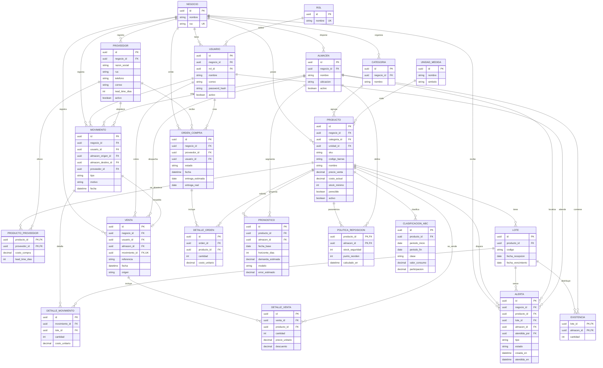

# Modelo entidad-relación de InventiX

Propuesta para el backend futuro, basada en los dos documentos entregados. No se ha implementado una base de datos.

- `NEGOCIO` delimita cada cliente SaaS. Las referencias deben pertenecer al mismo negocio; imponerlo con claves compuestas o validación transaccional.
- Unicidad: `(negocio_id, sku)` en PRODUCTO, `(negocio_id, ruc)` en PROVEEDOR, `(negocio_id, correo)` en USUARIO, `(producto_id, codigo)` en LOTE y `(negocio_id, nombre)` en CATEGORIA y ALMACEN.
- EXISTENCIA tiene clave compuesta `(lote_id, almacen_id)`; el stock de un producto es la suma de sus lotes. Cantidades enteras no negativas en existencias y positivas en detalles. Si se venden productos fraccionados, usar decimales para cantidades.
- MOVIMIENTO y DETALLE_MOVIMIENTO forman el historial inmutable. Entrada: destino obligatorio; salida/merma: origen obligatorio; transferencia: ambos y distintos. Actualizar existencias y registrar detalles en una transacción ACID. La carga inicial es un tipo de entrada.
- FEFO selecciona lotes vigentes por fecha de vencimiento. DETALLE_MOVIMIENTO conserva la asignación exacta por lote; una venta puede consumir varios lotes. Los no perecibles pueden usar lotes sin vencimiento.
- VENTA captura precios históricos en DETALLE_VENTA; su movimiento registra la salida física por lote. La referencia importada debe ser única por negocio y origen para evitar duplicados.
- PRODUCTO_PROVEEDOR resuelve la relación muchos a muchos; permite costos y plazos por producto. Los borradores y pedidos confirmados comparten ORDEN_COMPRA y sus detalles. La recepción se registra como movimiento; agregar `orden_compra_id` opcional a MOVIMIENTO al integrar ese flujo.
- PRONOSTICO guarda resultados por producto, almacén y horizonte 30/60/90. POLITICA_REPOSICION guarda el resultado vigente; CLASIFICACION_ABC conserva evaluaciones por período. No son modelos de IA implementados.
- ALERTA permite producto o lote opcionales según el tipo; almacén opcional para alertas globales y usuario opcional hasta su atención. Evitar alertas activas duplicadas para el mismo riesgo.
- Usuario, proveedor y producto se desactivan para preservar históricos. `password_hash` se usará exclusivamente en el backend; los permisos del frontend de demostración no ofrecen seguridad real.

El archivo `.mmd` contiene el diagrama editable Mermaid. El SVG y el PDF permiten visualizarlo sin instalar paquetes en el frontend.

